<!-- Generated by scripts/build-profile.mjs. Do not edit by hand: change the wording in scripts/profile-content.mjs and the numbers come from scripts/profile-data.json. -->

<b>English</b> · <a href="README.zh-TW.md">繁體中文</a>

<a href="https://wenyuchiou.github.io"></a>

Originally from Taiwan, now based in Bethlehem, Pennsylvania. I do my doctoral research in Civil &amp; Environmental Engineering at Lehigh University, in the Complex Adaptive Water Systems Lab. I began with empirical human behavior and human–water systems: survey design, psychometrics, and coupled flood-risk simulation. That foundation now informs how I evaluate generated behavior and design constraint-checked agent systems.

<h3>Research</h3>

<b>How do people decide under flood risk, and what do those decisions change?</b>

<a href="https://wenyuchiou.github.io/research/#observatory-stage-human-evidence">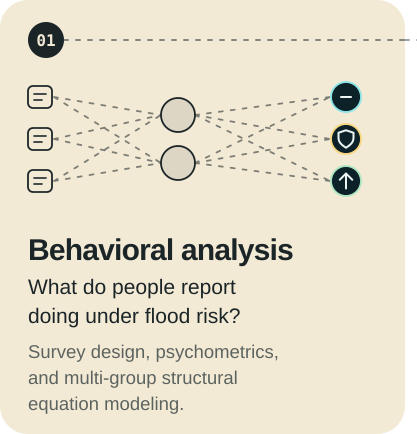</a><a href="https://wenyuchiou.github.io/research/#observatory-stage-llm-evaluation">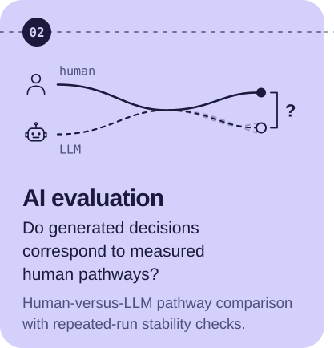</a><a href="https://wenyuchiou.github.io/research/#observatory-stage-external-feedback">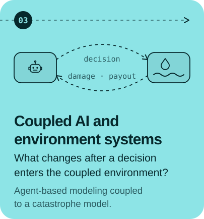</a>

<a href="https://doi.org/10.1029/2025WR042111">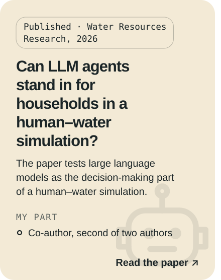</a><a href="https://wenyuchiou.github.io/work/floodabm/">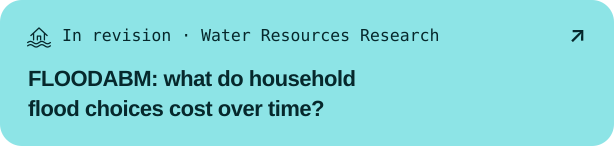</a>

<h3>Projects</h3>

<a href="https://github.com/WenyuChiou/awesome-agentic-ai-zh">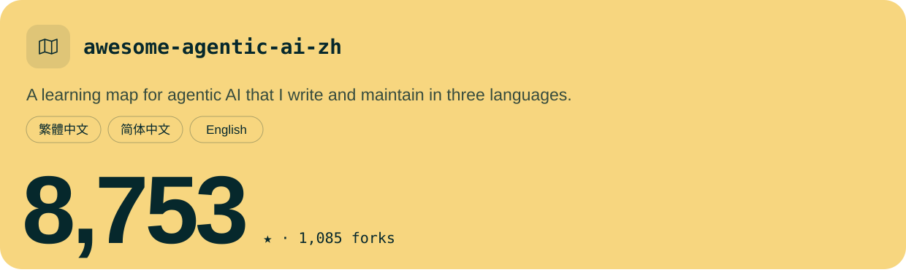</a>
<a href="https://github.com/WenyuChiou/ai-research-skills">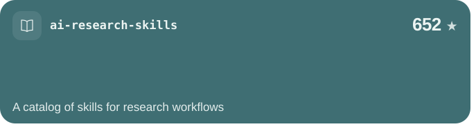</a><a href="https://github.com/WenyuChiou/academic-writing-skills">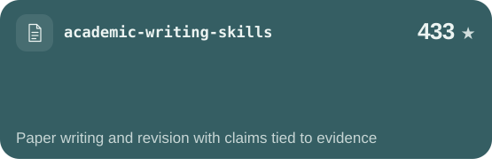</a>
<a href="https://github.com/WenyuChiou/zotero-skills">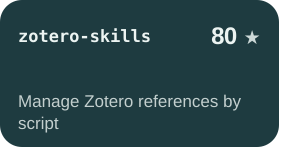</a><a href="https://github.com/WenyuChiou/research-hub">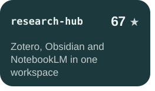</a><a href="https://github.com/WenyuChiou/codex-delegate">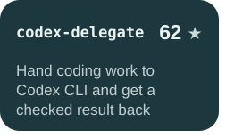</a><a href="https://github.com/WenyuChiou/agent-board">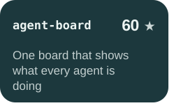</a><a href="https://github.com/WenyuChiou/agent-collab-skills">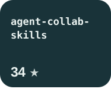</a>

<h3>Merged into other people’s projects</h3>

<a href="https://github.com/morluto/rea/pulls?q=is%3Apr+is%3Amerged+author%3AWenyuChiou">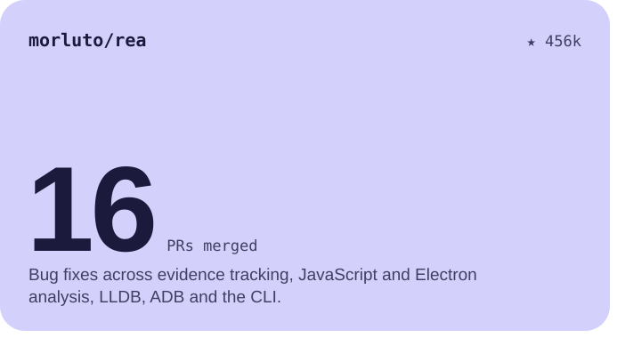</a><a href="https://github.com/ZhuLinsen/daily_stock_analysis/pulls?q=is%3Apr+is%3Amerged+author%3AWenyuChiou">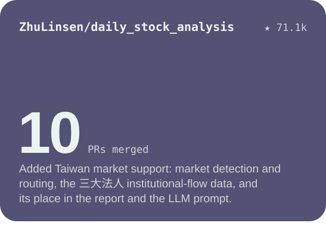</a>
<a href="https://github.com/BuilderIO/agent-native/pulls?q=is%3Apr+is%3Amerged+author%3AWenyuChiou">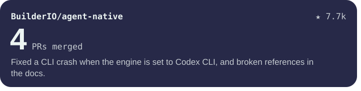</a><a href="https://github.com/langchain-ai/openwiki/pulls?q=is%3Apr+is%3Amerged+author%3AWenyuChiou">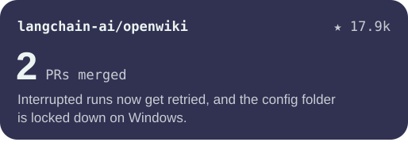</a>
<a href="https://github.com/Nanako0129/coralline/pull/10">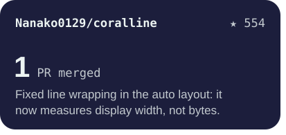</a><a href="https://github.com/NVIDIA/skills/pull/76">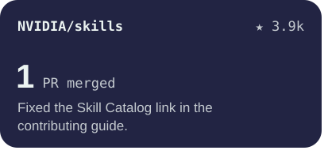</a><a href="https://github.com/punkpeye/awesome-mcp-servers/pull/6921">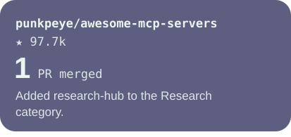</a>

<h3>Activity</h3>

Public repositories only. Numbers as of 2026-11-13, refreshed daily. · <a href="https://www.threads.com/@wenyu_chiou">Threads</a>
