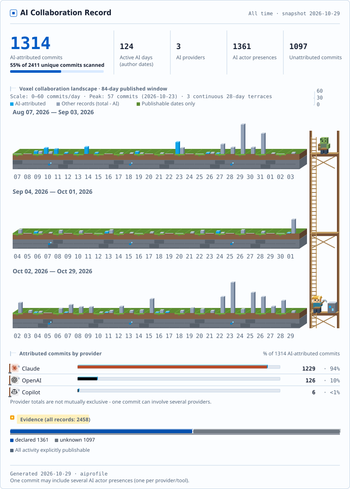

<!-- ============================================================
     WenyuChiou / WenyuChiou — 個人首頁 README（繁體中文版）
     英文版 landing page 見 README.md；此檔為語言切換連結進入的繁中鏡像。
     視覺系統與英文版一致：SVG banner + shields for-the-badge 區塊。
     Chinese badge 文字已 percent-encode（由 scripts 產生），請勿手改 URL。
     ============================================================ -->

<a href="README.md">English</a> · <b>繁體中文</b>

  <a href="https://wenyuchiou.github.io/zh/#decision-provenance">
    <picture>
      <source media="(prefers-color-scheme: dark) and (prefers-reduced-motion: reduce)" srcset="assets/research-loop-zh-TW-dark-static.svg?v=loop-1"/>
      <source media="(prefers-reduced-motion: reduce)" srcset="assets/research-loop-zh-TW-static.svg?v=loop-1"/>
      <source media="(prefers-color-scheme: dark)" srcset="assets/research-loop-zh-TW-dark.svg?v=loop-1"/>
      
    </picture>
  </a>

<!-- HIGHLIGHTS:START -->

  <strong>尋找 2027 暑期 AI 實習機會</strong> 
  Lehigh University · 美國 Bethlehem, PA · 預計 2027 年 12 月博士畢業

<table width="100%">
<thead><tr>
  <th width="280" align="left" scope="col">招聘履歷</th>
  <th width="280" align="left" scope="col">研究作品</th>
  <th width="280" align="left" scope="col">聯絡社群</th>
</tr></thead>
<tbody><tr>
  <td width="280" align="left" valign="top">
    
<a href="https://wenyuchiou.github.io/zh/hire/" title="招聘摘要"><picture><source media="(max-width: 1199px)" srcset="assets/profile-links/hire-zh-TW-compact.svg?v=columns-3"/><source media="(prefers-color-scheme: dark)" srcset="assets/profile-links/hire-zh-TW-dark.svg?v=columns-3"/></picture></a>

    
<a href="https://wenyuchiou.github.io/assets/Wenyu_Chiou_AI_Research_Resume.pdf" title="AI 研究履歷（英文 PDF）"><picture><source media="(max-width: 1199px)" srcset="assets/profile-links/resume-zh-TW-compact.svg?v=columns-3"/><source media="(prefers-color-scheme: dark)" srcset="assets/profile-links/resume-zh-TW-dark.svg?v=columns-3"/></picture></a>

    
<a href="https://wenyuchiou.github.io/assets/Wenyu_Chiou_Academic_CV.pdf" title="學術 CV（英文 PDF）"><picture><source media="(max-width: 1199px)" srcset="assets/profile-links/academic-zh-TW-compact.svg?v=columns-3"/><source media="(prefers-color-scheme: dark)" srcset="assets/profile-links/academic-zh-TW-dark.svg?v=columns-3"/></picture></a>

  </td>
  <td width="280" align="left" valign="top">
    
<a href="https://wenyuchiou.github.io/zh/" title="個人網站"><picture><source media="(max-width: 1199px)" srcset="assets/profile-links/portfolio-zh-TW-compact.svg?v=columns-3"/><source media="(prefers-color-scheme: dark)" srcset="assets/profile-links/portfolio-zh-TW-dark.svg?v=columns-3"/></picture></a>

    
<a href="https://scholar.google.com/citations?user=vSQ3zT4AAAAJ&amp;hl=zh-TW" title="Google Scholar"><picture><source media="(max-width: 1199px)" srcset="assets/profile-links/scholar-zh-TW-compact.svg?v=columns-3"/><source media="(prefers-color-scheme: dark)" srcset="assets/profile-links/scholar-zh-TW-dark.svg?v=columns-3"/></picture></a>

  </td>
  <td width="280" align="left" valign="top">
    
<a href="mailto:wec324@lehigh.edu" title="寄信給邱文昱"><picture><source media="(max-width: 1199px)" srcset="assets/profile-links/email-zh-TW-compact.svg?v=columns-3"/><source media="(prefers-color-scheme: dark)" srcset="assets/profile-links/email-zh-TW-dark.svg?v=columns-3"/></picture></a>

    
<a href="https://www.linkedin.com/in/wenyu-chiou" title="LinkedIn"><picture><source media="(max-width: 1199px)" srcset="assets/profile-links/linkedin-zh-TW-compact.svg?v=columns-3"/><source media="(prefers-color-scheme: dark)" srcset="assets/profile-links/linkedin-zh-TW-dark.svg?v=columns-3"/></picture></a>

    
<a href="https://www.threads.com/@wenyu_chiou" title="Threads"><picture><source media="(max-width: 1199px)" srcset="assets/profile-links/threads-zh-TW-compact.svg?v=columns-3"/><source media="(prefers-color-scheme: dark)" srcset="assets/profile-links/threads-zh-TW-dark.svg?v=columns-3"/></picture></a>

  </td>
</tr></tbody>
</table>
<!-- HIGHLIGHTS:END -->

  <a href="https://wenyuchiou.github.io/WenyuChiou/dist/dashboard.html">
    <picture>
      <source media="(prefers-color-scheme: dark)" srcset="./dist/badge-dark.svg"/>
      
    </picture>
  </a> 

&nbsp;

來自台灣，目前居住在美國賓州 Bethlehem。

我開發以人類行為證據為基礎的評估與受治理代理系統，應用於行為與人類—環境模擬。
我的工作串聯 937 戶實證資料、可解釋決策路徑、代理人基礎模型與明確限制，讓模型行為在改變耦合系統前即可接受稽核。

&nbsp;

從明確 Git 證據生成的動態協作礦場。由 GitHub Actions 每日更新 snapshot。

<a href="https://wenyuchiou.github.io/WenyuChiou/dist/dashboard.html">
  <picture>
    <source media="(prefers-color-scheme: dark)" srcset="./dist/summary-dark.svg"/>
    
  </picture>
</a>

  <strong><a href="https://wenyuchiou.github.io/WenyuChiou/dist/dashboard.html">開啟互動 dashboard ↗</a></strong>

&nbsp;

| | |
|---|---|
| [**FLOODABM**](https://github.com/WenyuChiou/FLOODABM) | 與災害洪水模型耦合、以代理人為基礎的（ABM）模型——Passaic 河流域（NJ，2011–2023）的家戶洪水調適 |
<!-- RESEARCH:START — 在此行上方新增研究 repo 表格列 -->
<!-- RESEARCH:END -->

`LLM Agents` · `AI Harness / Governed Agents` · `Agent-Based Modeling` · `Multi-Agent Systems` · `Catastrophe Modeling` · `Decision-Making Under Risk` · `Human-Environment Interaction`

&nbsp;

<!-- PUBS:START — 由新到舊；格式： - **[標題](連結)** — 期刊, 年份 -->
- [**Leveraging Large Language Models for Agent-Based Simulation of Human-Water System Interactions**](https://doi.org/10.1029/2025WR042111) — *Water Resources Research*, **62**(6), e2025WR042111 (2026)
<!-- PUBS:END -->

&nbsp;

| 專案 | 能幫上什麼忙 | GitHub 星數 |
|---|---|---|
| [**ai-research-skills**](https://github.com/WenyuChiou/ai-research-skills) | 引導 AI 協助研究，從文獻搜尋到論文準備。 |  |
| [**agent-collab-skills**](https://github.com/WenyuChiou/agent-collab-skills) | 讓多個 AI 代理分工、保存進度檢查點，並審查整合結果。 |  |
| [**zotero-skills**](https://github.com/WenyuChiou/zotero-skills) | 讓 AI 助理搜尋、新增、註解並整理 Zotero 文獻。 |  |
| [**research-hub**](https://github.com/WenyuChiou/research-hub) | 在本機研究工作區串聯文獻、證據、分析與論文。 |  |
| [**academic-writing-skills**](https://github.com/WenyuChiou/academic-writing-skills) | 規劃、撰寫、審查與修訂學術論文，並檢查證據與前後一致性。 |  |
| [**codex-delegate**](https://github.com/WenyuChiou/codex-delegate) | 由 Claude 將程式實作委派給 Codex CLI，再由 Claude 審查結果。 |  |
| [**Agent Board**](https://github.com/WenyuChiou/agent-board) | 一眼查看各個 AI 程式代理在做什麼，優先看到等待你處理的事項。 |  |
| [**awesome-agentic-ai-zh**](https://github.com/WenyuChiou/awesome-agentic-ai-zh) | 透過學習路線、動手練習與精選資源，學會使用及打造 AI 代理。 |  |
<!-- TOOLING:START — 在此行上方新增工具或學習資源表格列 -->
<!-- TOOLING:END -->

&nbsp;

精選已合併的 pull request：

| 專案／貢獻 | 改善了什麼 | 證據與狀態 |
|---|---|---|
| [**REA**](https://github.com/morluto/rea) | 修正 Electron 分析誤判、補上分析結果的來源連結並顯示正確檔案路徑；清理失敗時也保留已完成的除錯結果，讓分析更可靠、結果更容易追溯。 | [已合併 PR](https://github.com/morluto/rea/pulls?q=is%3Apr+author%3AWenyuChiou+is%3Amerged) |
| [**ZhuLinsen/daily_stock_analysis**](https://github.com/ZhuLinsen/daily_stock_analysis) | 新增台股支援——市場偵測與路由、三大法人資料抓取，以及 TWD 幣別／股利修正 | [已合併 PR](https://github.com/ZhuLinsen/daily_stock_analysis/pulls?q=is%3Apr+author%3AWenyuChiou+is%3Amerged) · 已合併 |
| [**langchain-ai/openwiki**](https://github.com/langchain-ai/openwiki) | 在 `chmod` 無作用的 Windows 上，收緊 `~/.openwiki` 的檔案權限 | [#367](https://github.com/langchain-ai/openwiki/pull/367) · 已合併 |
| [**BuilderIO/agent-native**](https://github.com/BuilderIO/agent-native) | 讓 CLI 在 `codex-cli` engine 下改走 Codex runner，而非直接崩潰 | [#1362](https://github.com/BuilderIO/agent-native/pull/1362) · 已合併 |
| [**Nanako0129/coralline**](https://github.com/Nanako0129/coralline) | 修正 auto-layout 過度換行——以顯示欄寬（而非位元組）計算 | [#10](https://github.com/Nanako0129/coralline/pull/10) · 已合併 |
<!-- OSS:START — 每列對應一個專案／已合併貢獻群組；只用事實動詞，不放星數 -->
<!-- OSS:END -->

&nbsp;

  
  
  
  
  
  
  
  
  
  
  
  
  
  

&nbsp;

<!-- TROPHY:START — 每日由 .github/workflows/trophy.yml 重新產生 -->

<!-- TROPHY:END -->

&nbsp;

- **實驗室** — [Complex Adaptive Water Systems (CAWS)](https://ethanyang28.wixsite.com/yceyang) · [Center for Catastrophe Modeling and Resilience](https://catmodeling.lehigh.edu/)

&nbsp;

正在尋求 **2027 年夏季全職實習**（約 5 月下旬至 8 月中旬），方向包括 LLM 評估、代理系統、行為模擬與 AI for Science。F-1 學生身分。聯絡信箱：[wec324@lehigh.edu](mailto:wec324@lehigh.edu)

  <!-- SNAKE:START — 每日由 .github/workflows/snake.yml 產生（提交到 output 分支） -->
  <picture>
    <source media="(prefers-color-scheme: dark)" srcset="https://raw.githubusercontent.com/WenyuChiou/WenyuChiou/output/github-snake-dark.svg" />
    <source media="(prefers-color-scheme: light)" srcset="https://raw.githubusercontent.com/WenyuChiou/WenyuChiou/output/github-snake.svg" />
    
  </picture>
  <!-- SNAKE:END -->

  <code>perceive → reason → verify → act · repeat</code>

