<!-- Generated by scripts/build-profile.mjs. Do not edit by hand: change the wording in scripts/profile-content.mjs and the numbers come from scripts/profile-data.json. -->

<a href="README.md">English</a> · <b>繁體中文</b>

<a href="https://wenyuchiou.github.io/zh/"></a>

來自台灣，目前居住在美國賓州 Bethlehem。我在理海大學 (Lehigh University) 土木與環境工程系的複雜適應水系統實驗室 (Complex Adaptive Water Systems Lab) 做博士研究。我的研究起點是人類行為與人類—水系統的實證研究：問卷設計、心理計量學，以及人類—洪災耦合風險模擬。這些基礎現在指引了我如何評估模型生成的行為，並設計具備限制檢查的代理系統。

<h3>研究</h3>

<b>人在洪災風險下怎麼做決定？這些決定又改變了什麼？</b>

<a href="https://wenyuchiou.github.io/zh/research/#observatory-stage-human-evidence">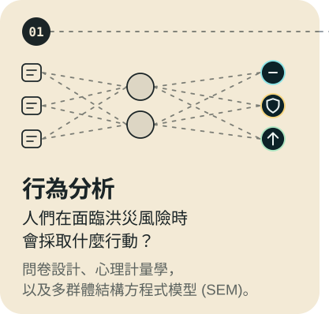</a><a href="https://wenyuchiou.github.io/zh/research/#observatory-stage-llm-evaluation">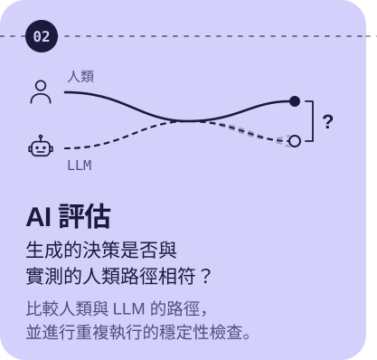</a><a href="https://wenyuchiou.github.io/zh/research/#observatory-stage-external-feedback">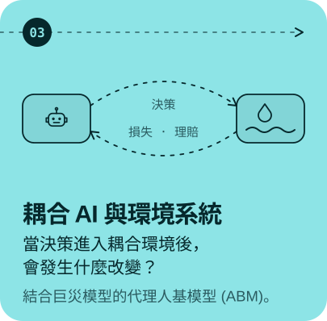</a>

<a href="https://doi.org/10.1029/2025WR042111">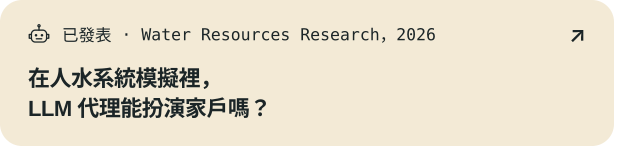</a>

<h3>專案</h3>

<a href="https://github.com/WenyuChiou/awesome-agentic-ai-zh">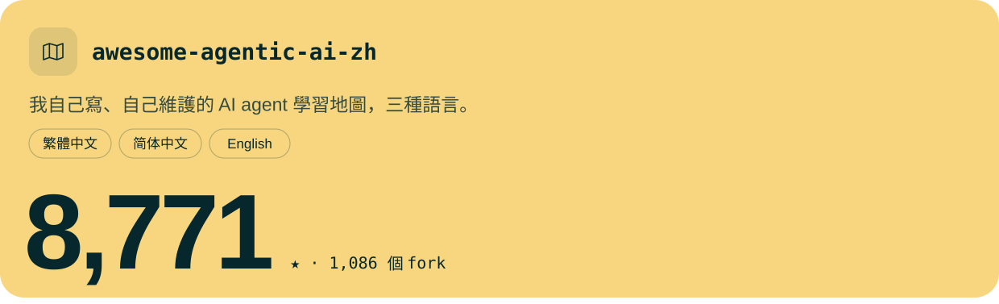</a>
<a href="https://github.com/WenyuChiou/ai-research-skills">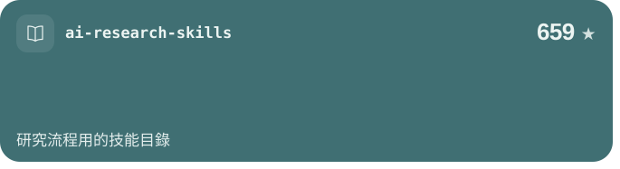</a><a href="https://github.com/WenyuChiou/academic-writing-skills">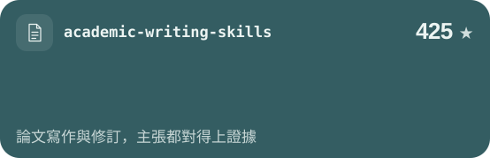</a>
<a href="https://github.com/WenyuChiou/zotero-skills">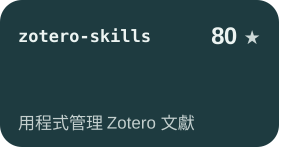</a><a href="https://github.com/WenyuChiou/research-hub">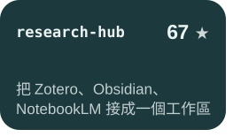</a><a href="https://github.com/WenyuChiou/codex-delegate">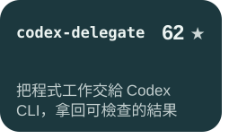</a><a href="https://github.com/WenyuChiou/agent-board">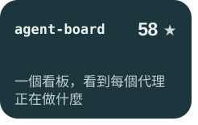</a><a href="https://github.com/WenyuChiou/agent-collab-skills">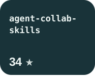</a>

<h3>合併進別人專案的 PR</h3>

<a href="https://github.com/morluto/rea/pulls?q=is%3Apr+is%3Amerged+author%3AWenyuChiou">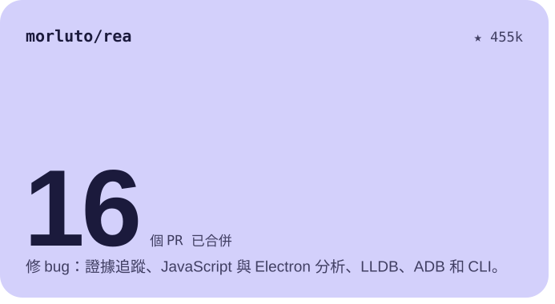</a><a href="https://github.com/ZhuLinsen/daily_stock_analysis/pulls?q=is%3Apr+is%3Amerged+author%3AWenyuChiou">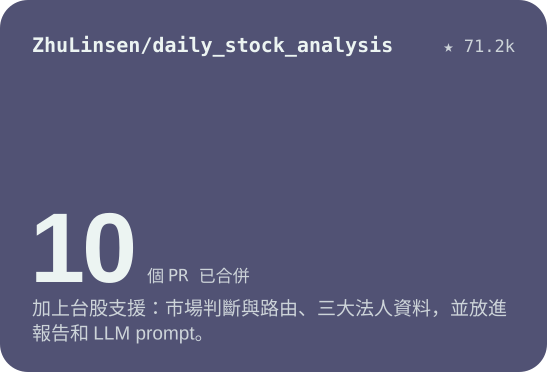</a>
<a href="https://github.com/BuilderIO/agent-native/pulls?q=is%3Apr+is%3Amerged+author%3AWenyuChiou">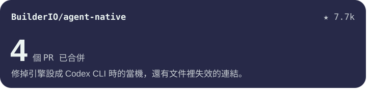</a><a href="https://github.com/langchain-ai/openwiki/pulls?q=is%3Apr+is%3Amerged+author%3AWenyuChiou">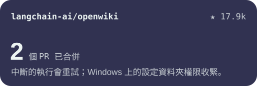</a>
<a href="https://github.com/Nanako0129/coralline/pull/10">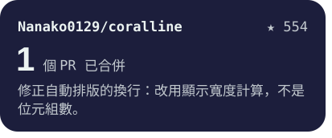</a><a href="https://github.com/NVIDIA/skills/pull/76">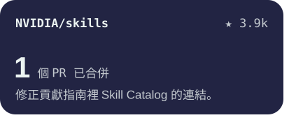</a><a href="https://github.com/punkpeye/awesome-mcp-servers/pull/6921">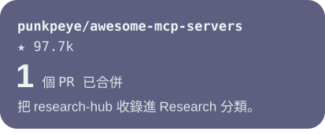</a>

<h3>動態</h3>

只算公開專案 · 2026-11-12 的數字，每天更新 · <a href="https://www.threads.com/@wenyu_chiou">Threads</a>
